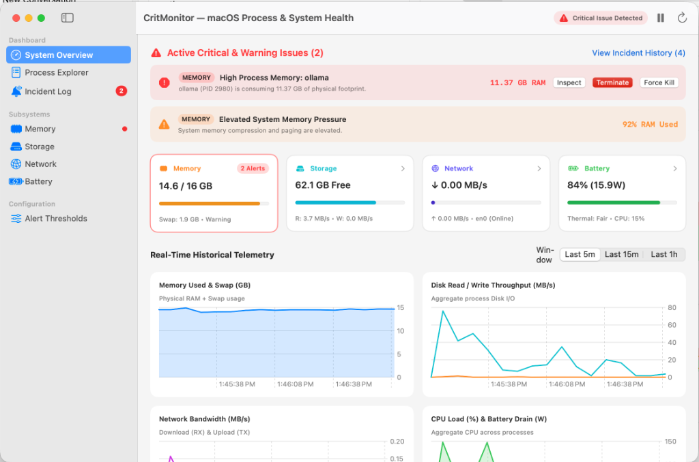

# CritMonitor — macOS Process & System Health Monitor

A native **Swift / SwiftUI** macOS application (`MenuBarExtra` widget + Main Dashboard Window) that continuously monitors processes and system telemetry under **standard user permissions** to detect, alert, and remediate critical issues across **Memory**, **Storage**, **Network**, and **Battery**.



## Key Features

- **Memory Monitoring (`Mach` + `libproc`)**:
  - Tracks physical footprint (`ri_phys_footprint`), wired, active, compressed RAM, swap usage (`vm.swapusage`), and macOS kernel VM pressure (`kern.memorystatus_vm_pressure_level`).
  - Detects both large memory footprints and rapid monotonic memory leaks (`+MB/min` per PID).
- **Storage & Disk I/O Monitoring (`statfs` + `rusage_info_v4`)**:
  - Tracks boot volume free capacity and real-time per-process read/write throughput (`ri_diskio_bytesread`, `ri_diskio_byteswritten`).
  - Alerts on low free disk space and sustained disk write thrashing.
- **Network Monitoring (`getifaddrs` + `/usr/bin/nettop` + `/usr/sbin/lsof`)**:
  - Tracks live RX/TX bandwidth and TCP retransmission rates per process without root privileges.
  - On-demand socket inspector (`lsof -Pan -p <pid> -i`) shows open local/remote endpoints per process.
- **Battery & Thermal Monitoring (`IOKit` + `AppleSmartBattery`)**:
  - Tracks battery charge %, live discharge wattage (`Voltage * InstantAmperage`), cycle count, battery health %, and `ProcessInfo.thermalState`.
  - Computes a composite per-process **Energy Impact Score** from CPU time, interrupt/idle wakeups, and I/O.
- **One-Click Remediation & Actionable Notifications**:
  - Graceful Terminate (`SIGTERM`), Force Quit (`SIGKILL`), Reveal in Finder, and Open Socket Inspector.
  - Built-in protection prevents accidental termination of macOS system processes (`kernel_task`, `launchd`, `WindowServer`, etc.).

## Quick Start

### 1. Run Live CLI Diagnostic Snapshot
```bash
swift run CritMonitor --cli-check
```

### 2. Build & Launch the Native `.app` Bundle
```bash
./scripts/build_app_bundle.sh
open CritMonitor.app
```

### 3. Run Unit Tests
```bash
swift test
```
